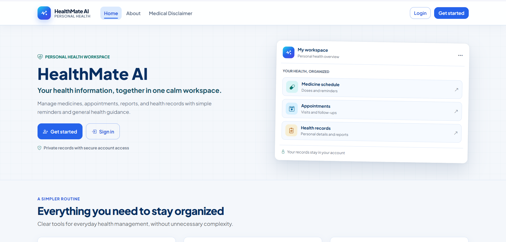

# HealthMate AI — Personal Health Management

<p>
  
  
  
  
</p>

HealthMate AI helps people keep health records, medicines, appointments, reminders, and medical reports together in one private workspace. It also includes an administrator portal and an optional AI assistant for general health information.

## Preview



## Features

- Patient accounts, profile, health records, medicines, appointments, and reminders
- Medical report upload and management
- Admin portal for users and health data
- Optional AI chat, recommendations, report summaries, and response exports
- Password recovery by one-time code

## Tech stack

Python · Flask · SQLAlchemy · MySQL · Jinja · Bootstrap · Vanilla JavaScript · OpenRouter

## Run locally

**Requirements:** Python 3.10+ and MySQL.

1. Create a MySQL database (default name: `ai_health_management`).
2. Copy `.env.example` to `.env`, then set your database credentials and a unique `SECRET_KEY`.
3. Install dependencies and create an admin account:

   ```bash
   python -m venv .venv
   # Windows: .venv\Scripts\Activate.ps1
   # macOS/Linux: source .venv/bin/activate
   pip install -r requirements.txt
   python -c "from run import app"
   flask --app run.py create-admin
   ```

4. Start the app:

   ```bash
   python run.py
   ```

Visit [http://127.0.0.1:5000](http://127.0.0.1:5000). Admin sign-in: `/admin/login`.

## Optional integrations

Set `OPENROUTER_API_KEY` in `.env` to enable AI features. Configure SMTP using the `MAIL_*` settings for password recovery emails. Without SMTP in development, OTP messages are printed to the server output.

## Deploy

A free deployment guide (Render + TiDB Cloud Starter) is available in
https://healthmate-ai-5dl3.onrender.com . The repo includes a `render.yaml` blueprint, so
Render can provision the web service straight from GitHub.

## Project layout

```text
app/          Flask factory, templates, static assets, application interfaces
models/       SQLAlchemy models
routes/       Flask blueprints and route handlers
utils/        Authentication, AI, uploads, email, OTP, and helpers
database.py   Table creation and legacy MySQL compatibility updates
run.py        Application entry point
```

> **Medical disclaimer:** The AI assistant provides general information only. It does not diagnose or replace guidance from a qualified healthcare professional.
